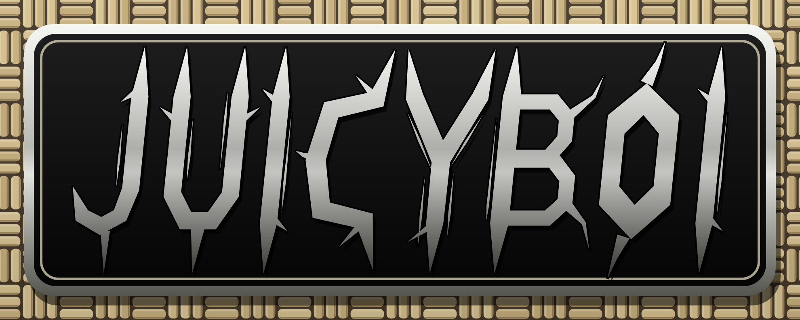
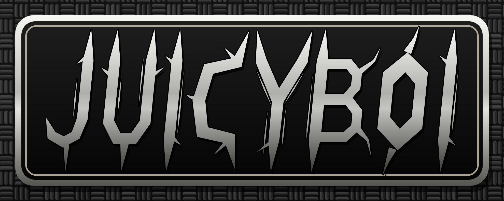

# Metal amp badge and pedal names (Rev3.2.1)

GUI only. The audio, parameters, saved state, plugin name ("juicyboi Rev3"), bundle
IDs and codes (`Jcyb` / `Jcb3`) are unchanged.

## 1. Badge lettering

The badge on the grille (Rectifier and 5150 faceplates alike) used to be the word in a
serif italic system font. It is now drawn as jagged black-metal capitals:

- Tall, narrow, slightly leaning letters. Every outline is a straight segment: no curves
  (C, U and O are built from angled flats; O is a slanted six-sided box).
- Stroke ends taper to long sharp spikes that overshoot above the cap line and below the
  baseline, with small thorns on the corners.
- A few hairline splinter strokes run beside the long main strokes.
- Steel fill (the same chrome gradient as the amp's trim, shaded darker towards the
  bottom), a dark outline and a soft drop shadow, on the existing black plate. The plate is
  larger than before (310 x 112 design units) so the spikes have room.

### How it is built

- `tools/metal_glyphs.py` defines each letter as polylines with a width at every vertex
  (a width of 0 gives a spike). It writes `Source/gui/MetalGlyphData.inc`.
  `python3 tools/metal_glyphs.py Source/gui/MetalGlyphData.inc` regenerates it;
  `python3 tools/metal_glyphs.py preview out.png` renders a preview (needs Pillow).
- The splinters and the lean come from a fixed per-letter seed **in the generator**. The
  results are baked into the `.inc` as plain numbers, so nothing is random at runtime and
  the lettering is identical on every repaint and on every machine.
- `Source/gui/MetalBadge.{h,cpp}` turns those outlines into one `juce::Path`
  (`metal::wordPath`) and `metal::drawWord` fits and fills it.
- It is a vector `Path`, filled at the physical pixel scale. The amp head's static layer is
  cached per physical scale, so the lettering is sharp on Retina and on 1x displays and at
  every resize from 0.7x to 1.6x. No bitmap, no font.

### Licence and trademarks

The outlines are original drawings made for this project from the reference style (jagged,
spiky, straight-stroke capitals). They copy no font, band logo or brand mark, so there is no
font licence to document and nothing to embed or ship alongside the plugin.

### Limits

- Only the letters needed by the badge exist: `I J U C Y B O`. `metal::canSpell()` tells
  you whether a string can be drawn; other characters are skipped. Add letters in
  `glyph_def()` in the generator and regenerate.
- Lower case is drawn as upper case.

## 2. "juicyboi" removed from the pedals

| Pedal | Before | Now |
|---|---|---|
| Tuner | "juicyboi" small line above "TUNE" | "TUNE" |
| Graphic EQ | "juicyboi GEQ-7" | "GEQ-7" |
| Boost (OD-808 / SD-1), Gate, Cab | no name on the pedal | unchanged |

The badge on the amp grille is now the only place the name is drawn. `Pedal::getTitle()` and
`TunerPedal::nameplateText()` expose the engraved names so the tests can check this.

## Tests

`EditorTest.cpp` checks that the badge can spell the word (also in lower case), that its
path is identical on every call, that it is straight-edged with spikes overshooting the cap
line and baseline, that two renders of the badge are pixel-identical, that it shows steel
lettering on the plate, that no pedal title contains "juicyboi", and that the plugin name is
still "juicyboi Rev3".

## Screenshots

`Tests/Screenshots.cpp` writes `rev3.2.1-*` images (badge close-ups at 6x, full UI,
pedalboard, tuner and EQ).
